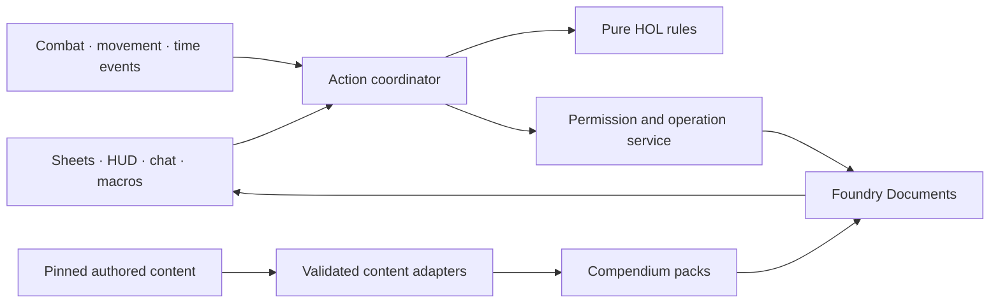

# Heroes of Legend — Foundry V14 build specification

Version 0.1, October 17, 2026. Supports issue #2. **Status: proposed software specification for review.** Rules authority is established in [rules-authority.md](rules-authority.md); engineering choices are proposals unless explicitly confirmed there.

## 1. Product goal

Deliver an installable V14 system that runs the current Heroes of Legend rules with comprehensive automation. A player should choose what their hero does and the system should handle all defined mechanical consequences, while the Dungeon Architect (DA) controls fictional judgments, hidden information and legitimate overrides.

Bruce explicitly requested maximum automation and use of Foundry features. The first playable slice is a development milestone, not the final automation boundary. Full release includes character building, all catalog entries, player and DA combat, target selection, action costs, reaction windows, damage/healing, conditions, movement, summons, wounds, crafting, advancement and session tools. Every catalog entry must be classified as automated, requiring a named human choice, or a documented release blocker.

No silent fallback from unsupported mechanics to a misleading “automated” result. A narrative condition such as “a plausible anchor” can prompt the DA once; the resulting movement/cost/effect should then execute automatically. A defined Burning tick should not require repeated manual damage buttons.

## 2. Scope and staged delivery

| Stage | User-visible result | Automation expectation |
|---|---|---|
| Foundation proof | A character, creature and Basic Melee can be loaded, rolled and persisted. | Validated V14 package, typed data and reliable dice/chat. |
| Playable alpha | A small encounter including defense, damage, turns, common conditions and recovery works with two clients. | Automatic standard outcomes; clearly labeled temporary omissions. |
| Feature beta | Creation, advancement, inventory, crafting, wounds, full combat economy, movement, reactions and summons work. | All general mechanics automated; full catalog coverage audit underway. |
| Full release | Approved player and completed DA/bestiary content, integration tests, polished sheets and distributable release. | Every mechanical catalog behavior implemented and tested, or explicitly accepted by Bruce as a named exception. |

Initially support V14 only. No migration from Neon Relic, legacy HOL or V13 worlds is required. Optional module integrations must not be dependencies for ordinary HOL play. Automated encounter difficulty remains advisory until the game's balance model is certified; this does not prevent automatic budget calculation.

## 3. Foundry feature plan

| Foundry feature | HOL application | Acceptance boundary |
|---|---|---|
| Actors and Token actor deltas | Characters, creatures and summoned forms; independent unlinked NPC instances. | Damage one token without changing a second token or the compendium prototype. |
| Embedded Items and compendiums | Abilities, signatures, origins, gear, recipes, wounds and searchable reference content. | Drag/drop respects acquisition rules; preview and source links remain available. |
| ApplicationV2, dialogs, detached windows | Character/DA/summon sheets, builder, browsers, reaction and outcome choices. | Native DOM handling, accessibility and pop-out behavior; no sheet-only rules calculations. |
| Native dice and ChatMessages | Transparent retained dice, outcomes, declarations, defense requests and audit history. | Whisper/blind modes honored; reload does not create fresh rolls or reapply effects. |
| Combat, Combatants and tracker | Alternating sides, side selection, action budgets, reactions, anchored timers. | No initiative-card or descending-initiative substitute. |
| ActiveEffects and statuses | Typed contributions, exact expiry, icons and duration labels. | Highest-value rules and temporary/starred contributions are preserved. |
| Grid, movement and walls | Range, terrain, occupied spaces, jump limits, forced movement and collision sequences. | Waypoint-aware validation and interruption; no wall crossing or extra distance from placement. |
| Regions, terrain and scene levels | Ability areas, hazards, difficult ground, lasting zones and vertical scene context. | Exact HOL affected-square semantics; levels constrain visibility and eligibility. Cross-level rules need the decision gate below. |
| Vision, detection and lighting | Printed senses, blindness, hidden/invisible states, light-emitting abilities. | Do not equate game-state Hidden with a global GM-only hidden token. Never reveal through unsupported senses. |
| Token HUD, bars and controls | HP, status ratings, action state, summon commands and range indicators. | Same permission checks and resolution path as sheets. |
| Journals and map notes | Linked player rules, DA guidance, adventure locations and scene notes. | Restricted information stored in restricted documents, not just hidden HTML. |
| RollTables | Wound-table browsing and keyed lookup; approved random tables. | Wound selection uses the custom retained/sorted roll, not uniform random selection over rows. |
| World time and calendar | Treatment/day limits, crafting time and noncombat durations. | Explicit game-day boundary; no wall-clock reset or hidden passage of game time. |
| Scenes, playlists and cards | Encounter setup, optional approved scene ambiance, printable/shareable ability presentations. | Use native Cards only if a demonstrated workflow benefits; HOL does not acquire a random hand/deck rule. |
| Macros, hotbar and API | Actor-aware shortcuts for owned abilities and common actions. | Resolve stable UUIDs and actor context; stale macros fail intelligibly. |
| Settings, localization and tours | World automation policy, per-user layout, English strings and onboarding. | Default is full automation; settings do not quietly rewrite HOL rules. |

The feature choice follows the game. Native features should simplify play, not add unrelated subsystems.

## 4. Architecture

Proposed implementation: ES modules with JSDoc, native Handlebars V2 views, scoped CSS, Node 24 build tooling, a small bundler and the official Foundry CLI for packs after its validation spike. Use lockfiles. TypeScript is an acceptable alternative if adopted in the foundation issue; do not create a separate framework application inside Foundry.

**Rules layer:** deterministic calculation of roll tier, prerequisites, damage, condition contributions, resource conversions and movement costs. No globals, writes or DOM.

**Document layer:** TypeDataModels, derived data, embedded Item relationships and serialization. Derived values are recalculated without database writes or feedback loops. Keep creation-time benefits distinct from current effective attributes.

**Services:** acquisition ledger, action resolution, combat phases, damage, effects, movement, summons, recovery, inventory, crafting and content updates. All entry points use the same services.

**UI:** render data, collect valid choices and explain outcomes. It does not become an alternate implementation of game rules. No parsing chat HTML or card prose to recover mechanics.

**Adapters:** core APIs, pack compilation and optional integrations. Restrict overrides to documented extension points. [V14 research](research/foundry-v14.md) records the API baseline; [data-contracts.md](data-contracts.md) defines proposed storage.

## 5. Action resolution and authority

The common pipeline is: **declare → validate → reserve action → resolve interruptions → revalidate → pay remaining costs → roll or resolve no-roll → choose required outcomes → apply → record → expire/check follow-on effects**.

Targets, damage-type choices and opportunity triggers are fixed before rolling. Additional HP or item costs are paid only if a committed action continues after an interruption. A canceled-before-commit dialog costs nothing; a committed action permanently stopped by an opportunity spends its action but not an unspent potion or HP cost. Explicit card exceptions override the general sequence.

For maximum automation, an authorized owned action applies permitted outcomes automatically. When an outcome changes an unowned target, a designated active GM service validates and applies it. Human approval is required only for a genuine ruling or an explicit world policy, not for every ordinary point of damage.

Use persisted operation IDs and phases. Repeated clicks, hooks, reconnects and two GM clients must not double-spend or double-apply. The GM reads a persisted request and its actual author, verifies actor ownership, card, costs, targets and current state, then recomputes consequences. Do not trust a socket payload's claimed user, permission, roll total or arbitrary update object. Transport notifications may announce a pending request, but cannot authorize it.

Foundry updates across multiple documents are not assumed to be an atomic transaction. Record each completed target/resource step; serialize operations that touch the same actor; detect stale state; stop and expose a recoverable partial state after failure. Resumption applies only missing steps. GM undo restores recorded changes only if intervening state permits it; otherwise offer a reconciliation diff. Never reroll during retry.

No active GM: owned rolls and permitted own-document changes remain available; cross-owner automation stays visibly pending. Revalidate on GM return, including targets, action freshness and paid costs. Disconnects must not create a fake success.

## 6. Resolution, targeting and damage

**HOL-R01:** Roll `3d6 + one attribute`. Boons/Banes cancel, net extras cap at three. Roll 3–6 dice, retain best three for Boons or worst three for Banes. Store all faces and retained indices. Weak ≤8; Standard 9–14; Strong ≥15. Retained natural 111 means Weak plus complication; retained 666 means Strong plus benefit regardless of attribute. No numerical skill bonus. Special death and wound rules use their own handlers.

**HOL-R02:** Player-controlled attacker makes one attack roll, including PvP. The defender does not also roll. A DA-controlled attacker requests the target's printed defense attribute; Weak defense maps to Strong attack, Standard to Standard, Strong to Weak. NPC-versus-NPC uses one defender roll, handled by a player or the DA without transferring control. Consequential NPC tasks use the acting NPC's attribute.

**HOL-R03:** Store attack and defense table orientation explicitly. Evasion and Threat are signed Boon/Bane contributions, not additions to the total. Use the approved creature/summon perspective conversion once. A player's area attack uses one roll with the worst applicable net target modifier; NPC area attacks give each affected player a defense roll. Apply per-target resistance and conditions independently. A target being a selected token alone does not establish legal sight/path/range.

**HOL-R04:** Outcome damage is fixed. Never add the attribute again or roll weapon damage. Aggregate components of the same damage type, add highest applicable weakness (normal cap 3) once per present type, then subtract highest matching resistance (cap 3) from that type, floored at zero. Sum components; a damaging event has minimum total 1, not minimum 1 per component. Non-damaging effects do not acquire damage. Preserve original and post-resistance components for wound selection. Narrative vulnerability supplies only its printed rule.

**HOL-R05:** A complete outcome includes all its stated riders; lower-tier bullets are not cumulative. Defense never adds an unprinted save. Free attacks use their specified attack and normal roll; free attacks cannot trigger further free attacks. Attach an origin chain ID to enforce that boundary.

**HOL-R06:** Healing caps at missing HP and uses Life resistance, minimum 1 only when HP is missing. Printed spell costs 1/3/7 HP are upfront, bypass resistance and must leave the payer above 0. Healing requires the printed hand/equipment conditions. A summon cannot receive healing. An eligible healing-harmed creature receives the spell's attack-mode Life damage, retaining its cost/range/action and excluding beneficial riders. Potions have their own fixed restoration and inventory check; they are not attack spells.

## 7. Character creation and development

The resumable builder must implement the sequence, not just present independent dropdowns:

1. Six base attributes each −2..+2, totaling +3. Freeze the creation baseline; later item effects cannot change earlier DP or HP calculations.
2. Ancestry, two of five traits, independent culture and background; select one complete grant pair from each origin.
3. Stage 0 pool `10 + Knowledge + Reason + Guile`, with negative modifiers and duplicate compensation. Grant required ranks before purchases. Eligible Novice abilities cost 2 DP; no discipline purchases. Expire unused stage-0 DP explicitly.
4. Class prerequisites: required attributes each ≥0, except Odd. Two distinct listed rank-1 disciplines, compensation for duplicates and a chosen level-1 signature.
5. New stage-1 pool with the same base formula plus its own duplicate compensation. Buy ranks sequentially at the class's exact prices and eligible abilities. Expire unused stage-1 DP.
6. Resolve acquisition grants once. One compatible weapon may serve multiple abilities; sale never reactivates the grant. Recipe knowledge does not grant materials or finished products.
7. HP = 12 + ancestry + class + creation Fortitude + explicit benefits. Capacity = 10 + 3 × effective Brawn; Speed = max(0, ancestry base + effective Agility − excess Bulk), plus explicit applicable effects. Stability defaults 0, highest explicit source, cap 3.
8. Starting Grit 2; starting coins 40 plus ancestry/culture/background/class contributions. Resolve grants before shopping. Track coins, hands and Bulk, including the pack itself.

Later milestone levels grant `8 + new level` DP from level 2, bankable and spendable in a DA-approved safe place. Tier minimums 1/3/7 and costs 2/4/8; Novice allowed in stage 0. No card chains, multiclassing or numerical skill ranks. Discipline ranks 1–3 require sequential purchase, no additional level gates. Class signatures are class-and-level gated, with grants at 1/3/7 and eligible extra purchases. Grit grants +1 at 3 and 7; no routine recharge. HP growth requires explicit benefits and per-level purchase limits.

Each purchase/grant records source, stage, prerequisites at that time, DP delta, resulting items and transaction ID. Drag/drop opens the same acquisition flow. GM corrections require a reason and validation report; deleting an Item does not automatically refund historical DP or erase scars. Respec is a separately approved workflow, not implied by editable fields.

## 8. Combat and reactions

**HOL-C01:** One opening unmodified 3d6; 12+ means player side first, otherwise opposition. Honor an established ambush exception. That side starts every round. Alternate sides, each selecting an eligible unacted participant; when one side is exhausted, the other finishes. Persist starting side, current side, acted IDs, current actor and phase. New participants, removal and rewind follow the decision register until their exact policies are settled.

**HOL-C02:** Refresh Main, Maneuver, Reaction and Speed movement at that actor's turn start. Main converts to Maneuver, Maneuver to a further movement allowance; never upward. Track multiple Maneuvers/allowances with counts, not one Boolean per category. Original movement plus conversion of Main and Maneuver permits three movement allowances. Defense costs no Reaction.

**HOL-C03:** Resolve Dying turn-start choice, applicable expiries and action-category selection in a defined tested phase sequence. Dazed/Grappled restrict categories at turn start, using the greater restriction. Changes during the turn do not recompute chosen categories or undo spent actions. Grappled still stops movement immediately; paralysis and helplessness retain immediate restrictions. Do not auto-select the player's remaining categories.

**HOL-C04:** Before provoking voluntary movement, casting beside an enemy, standing, stowing or retrieving, offer eligible enemies a Basic Melee opportunity using their Reaction. Pause the originating workflow and resume only if capable. Damage alone does not cancel it. Forced movement never provokes. A human chooses to use a reaction; the system finds eligibility, pays costs, resolves the attack and resumes. Multiple opportunities require a deterministic DA-selectable ordering until approved otherwise.

**HOL-C05:** Resolve end-turn effects, then temporary condition decay. Conditions gained during that turn also decay then. Summons' anchors use their controller's turn, including when uncommanded. Track each event ID so reloads/backtracking cannot tick damage twice. Combat cannot silently bypass a pending Dying resolution; safe breath is an explicit DA-approved transition.

## 9. Conditions and ongoing effects

Maintain individual source contributions and derive the displayed condition. Temporary and starred portions stay separate; only temporary contributions decay. Binary states do not stack numerically. Maintained grapple links include grappler, target and contribution; release removes that contribution from both participants.

| Condition family | Automation |
|---|---|
| Burning / Freezing | End-turn typed damage equal to rating, resistance/minimum rules, then decay. |
| Bleeding | End-turn rating damage bypassing resistance, then decay. |
| Poisoned / Frightened | Contextual Banes; Frightened checks stated source perception, prompting only where senses/fiction cannot decide. |
| Slowed | Derived Speed reduction, floor 0. |
| Dazed / Grappled | Category restriction at turn start; Grappled also zero movement and target-rating attack Boons. |
| Blinded / Deafened | Duration-only loss of the sense, corresponding targeting/detection restrictions. |
| Asleep / Paralyzed / Unconscious / Petrified | Printed immediate restrictions; one shared three-defense-Bane helpless penalty, not four stacked penalties. |
| Prone / Hidden / Invisible | Binary or source-defined state, with distinct movement and visibility behavior. No invented prone combat bonus. |

Apply highest matching numeric bonuses/resistance/weakness/Stability rather than generic ADD effects. Boons/Banes use their own additive and cancellation rules. Main-action reduction of Burning/Bleeding/Freezing requires a plausible method and lowers appropriate temporary rating; persistent remedies follow their sources.

Use V14 ActiveEffects for persistent documents and supported expiry, with a HOL timing coordinator for rating damage/decay and controller anchors. One subsystem owns each expiration. Duration words such as “next turn,” “scene” and “one hour” must become explicit anchors, never guessed seconds.

## 10. Recovery and wounds

Character survival states: **active → Dying / stabilized → active / Last Words → dead**. Ordinary creatures die at 0; summons disappear. Entering Dying creates one wound. Additional damaging events while Dying add one mark each without another wound. Damaging a stabilized character back into Dying creates a new wound and one mark.

Wound roll: `min(5, 3 + prior scars)` d6, retain highest three, sort ascending, concatenate digits. This is not a sum or an attribute roll. Select table from the largest post-resistance component; player chooses ties. If all components are fully resisted, choose among original types. Skip inapplicable anatomy by advancing to the next listed result. Five tables × 56 outcomes = 280 keyed results, including 666 Last Words. New wounds count after their roll; treated scars still count.

At Dying turn start choose Grit or Fortitude death roll before seeing dice. Grit spends one and restores full HP, preserving the wound. Weak adds one mark; Standard unchanged; Strong stabilizes at 0 and clears marks; retained 111 adds two marks; retained 666 restores 1 HP and clears marks. Three marks or wound 666 starts Last Words: speech only, death at the end of the second following turn. Ordinary healing/Grit cannot reverse it.

Stabilize costs a Maneuver, clears marks, leaves 0 HP and inability to act. Healing above 0 clears marks and ends HP-caused unconsciousness only. A safe breath restores HP after immediate hazards and Dying are resolved; it does not restore Grit or erase wounds.

Treatment checks the exact capability, full activity time, once-per-wound-per-game-day limit across all healers, and 1/2/3 recovery progress. Reaching RV removes exactly listed penalties while keeping the scar. Immediate wound consequences fire once; temporary conditions do not restart because the wound Item remains. Replacement/prosthesis remedies require explicit records.

## 11. Movement, areas, vision and levels

Implement square-grid costs: normal/diagonal 1; difficult 2; standing 2 movement; no passage through standing occupied squares; passage through prone occupied squares costs 2 and cannot end there. Validate footprints, terrain and walls along waypoints. Climbing/swimming normally cost 2; capability and plausible routes still matter. Automate approved jump formulas and approach checks. Falling is 3 physical per complete two squares with physical resistance, subject to exceptional surface rulings.

Forced movement applies initial Stability once, then spends terrain cost. A positive remaining budget enters the final square even when terrain costs more. At creature contact, resolve collision damage using movement remaining before deducting the newly struck creature's Stability. Track visited creatures to prevent double charging. Hard obstruction stops movement, adds 1 to remaining-budget collision damage, and permits the original mover's one-square backward bounce if legal. Stop moving groups at the last configuration where everyone fits; the DA chooses ambiguous exact arrangements. Automate the calculation, preview and legal candidate spaces rather than asking the DA to do the arithmetic.

Area targeting supports printed connected edge-sharing squares, directional rectangles, lines and radii through a canonical set of affected grid cells. Use Region previews/persistence when appropriate. Check each selected square's range, walls and inclusion rules; no friendly-fire exclusion unless the card grants it. Persistent zones use source-linked region/effect records and cleanup on expiry. Movement and damaging-zone triggers must have per-event guards.

Integrate printed senses with native vision/detection/light sources; restore source-aware configurations when effects end. Test multiple levels, elevations, ceilings and occlusion so automation never targets through floors. Cross-level HOL distance, vertical summon tether and airborne incapacitation have not been established by the current sources: preserve the visible scene context and obtain a specific ruling before applying ambiguous mechanics. This is a narrow rules gap, not a reason to omit Foundry scene-level support.

## 12. Summons

Instantiate a distinct summoned-form Actor/token from an explicitly eligible player profile; do not merely give ownership of the DA stat block. Persist controller actor/token UUIDs, source ability, eligibility, expiry and activation record. No category inference from creature name, no automatic extracted treasure.

Controller Main grants one summon Main + Maneuver, with no extra free movement. Controller Maneuver grants one summon Maneuver + movement. Conversions apply. One command per summon per controller turn; newly summoned immediate free Main command consumes its command for that turn. Different summons can receive the two paid commands. No count cap, independent turns, Reactions, opportunities, summon chains, unattended work or ongoing follow orders.

Use summon printed attributes/outcomes. Its controller pays the printed healing HP cost once before resolution, remains above 0, and the summon uses its own roll. Summons cannot receive healing, vanish at 0, and leave no body. They remain tangible and normally movable/grappleable.

Check tether after each meaningful movement waypoint and controller/summon state change, not only at destination. Use the nearest occupied squares; exactly 6 remains valid, beyond 6 immediately ends it, even if a later waypoint would return within range. Controller unconsciousness/death also ends it. Resolve effects/durations at controller anchors even without commands. Reload reconstructs links without spawning duplicates.

## 13. Equipment, crafting and noncombat tools

Equipment tracks compatible use, held/worn/carried state, hands, Bulk, explicit grants, coins and inventory die. Consumable die ladder is d20 → d12 → d10 → d8 → d6 → d4 → out; step down only on 1, after the use succeeds. Inventory checks do not inherit action-roll Boons/Banes. Respect per-use/person-day/hour intervals and prevent split-container exploits.

Potions use the fixed value and Life resistance, giver's free hand/Maneuver and recipient's Reaction unless at 0 HP, then inventory check. Spell healing is a separate workflow.

Crafting requires known recipe, prerequisites, actual materials/tools and printed time. Record in-progress jobs, completed outcomes, supply checks and permitted step caps. No group crafting, recipe derivation or wound-treatment rolls. World time advancement updates eligible jobs once; it does not silently auto-complete activities the character could not perform.

Group tasks outside combat record binary/cumulative type, declared target, participants and one contribution per attempt: Weak/Standard/Strong = 1/2/3. A participant aids or contributes, not both. Cumulative progress persists. Perception uses Reason; concealment uses Agility without an opposed observer roll. Ordinary travel has no routine roll/exhaustion track. DA reference tools provide approved encounter budgets, creature selection and scene setup while labeling balance guidance accurately.

## 14. UX and content completeness

**Character sheet:** persistent HP/Grit/conditions/action bar; summary, abilities, equipment, development, wounds and identity sections. Search/filter by action, tier, discipline, role and usability; show a specific reason when blocked. Favorites aid access without limiting the learned repertoire.

**DA creature sheet:** defenses, Evasion/Threat, resistance/weakness and actions in play order; clearly labeled defense-outcome columns. Shared actions appear once; unique restrictions stay with the ability. Summon view uses attacker outcomes and command status.

**Chat:** original dice, kept/discarded indicators, modifier sources, perspective, selected complete outcome, payment, target effects and actual apply status. Show natural benefit/complication separately. Required choices appear inline; automated actions report what happened. Retrying a display render cannot change state.

**Content browsers:** eligible/unavailable explanations, grant preview, type/tier filters, source links, draggable records and a DA-only bestiary. All rules remain readable when automation is disabled for a table ruling. Keyboard use, visible focus, text labels, light/dark themes and contrast are required. Tier numbers remain visible without relying on color.

## 15. Quality and release gates

Use [acceptance scenarios](acceptance-scenarios.md), a pure-rules suite, schema/import tests and licensed Foundry integration runs. Test GM plus at least two players, an additional GM, offline authority, synthetic tokens, reload during a pending action, stale requests, permission denial, blind rolls and mutation retries. Scan logs for deprecated APIs used by HOL.

Measure representative large sheets and full-compendium searches on a recorded reference environment; proposed targets are under 500 ms for warm local sheet render and under 300 ms for indexed local search, excluding network latency. These are engineering targets to calibrate, not measured results. Avoid eager loading every full document on each keystroke.

Release requires final source intake, content automation coverage, stable IDs, migrations from earlier HOL test releases, cross-platform build, reproducible package contents, version assertions and installation from the actual release manifest. Do not ship a source ZIP as the installable artifact. Select code/content licenses and asset notices before distributing packs. Keep system version, schema revision and content revision distinct.
